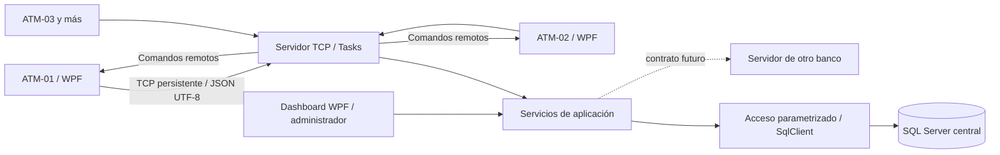

# Arquitectura del sistema

El servidor escucha con TcpListener en todas las interfaces IPv4; el puerto se lee de Parametro en SQL Server. Cada conexión tiene una Task asíncrona, un escritor serializado y un lector con tamaño máximo. El registro reserva el código y rechaza otro socket con la misma identidad. La reserva se libera después de registrar la desconexión, evitando que la limpieza de una conexión vieja pise una nueva.

`ProtocoloCompartido`: contrato de mensajes y cálculo acotado de alternativas de billetes. `Infraestructura`: conexiones SQL y parámetros. `Aplicacion`: servidor TCP, cliente TCP, autorización administrativa e interfaz futura entre bancos. `Servidor` y `Cajero`: presentación WPF. `PresentacionCompartida`: tema y utilidades de formularios/exportación. `Pruebas`: verificación reproducible y capturas.

Las reglas financieras están centralizadas en procedimientos SQL ejecutados por el servicio del servidor. Las validaciones de la interfaz ayudan al usuario; SQL vuelve a validar todo. La aprobación se envía solo después de COMMIT. SqlClient usa tiempo máximo de comando de 8 segundos; el cliente espera como máximo 10 segundos. Una respuesta 96 o un corte no se interpreta como autorización para repetir un movimiento.

Las conexiones SQL de ejecución adoptan el usuario limitado CajeroServidor. No se usa sa ni se distribuyen credenciales SQL a los cajeros. Pooling se desactiva para que el contexto de seguridad NO REVERT termine al cerrar cada conexión. La cuenta Windows inicial necesita permiso para adoptar ese usuario; ver instalación.

Una operación autorizada bloquea las filas necesarias con UPDLOCK/ROWLOCK y valida el consumo del usuario en todo el día usando la fecha de SQL. Saldo, billetes, encabezado, detalle y resultado idempotente se confirman en una transacción. Las restricciones de base son una segunda defensa contra saldos o cantidades negativas.

Se permite únicamente una instancia central del servicio de escucha por base de datos. Un reinicio del servidor cierra sesiones previas y marca desconectados los cajeros; estos se registran otra vez. La interfaz permanece en su hilo WPF; la E/S es asíncrona.

Un heartbeat no cuenta como actividad de la sesión de usuario. Cliente: cierre a 60 segundos sin teclado/clic; servidor: vigencia de 120 segundos de actividad de negocio. Token: aleatorio, asociado al usuario, tarjeta y cajero, con hash persistido y vencimiento máximo de 120 segundos.

El transporte interno es TCP/JSON sobre la LAN del ejercicio, según el enunciado. SQL usa Encrypt=True; TrustServerCertificate=True se limita al ejemplo local con certificado autofirmado. El protocolo externo y su protección de transporte se acordarán por separado antes de conectar otros bancos.
