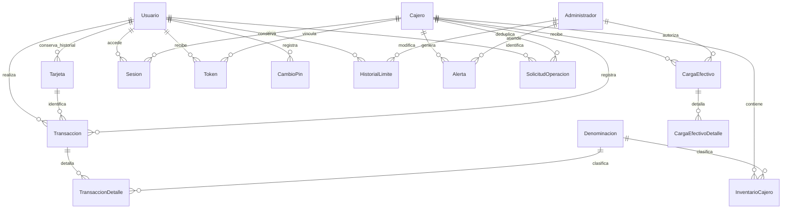

# Modelo relacional y scripts

Las tablas separan usuarios, tarjetas, denominaciones, inventario, encabezados y detalles de efectivo. Existe una tarjeta activa por usuario mediante índice único filtrado; el número de tarjeta es único y de 16 dígitos. HistorialLimite, CambioPin, Bitacora y tarjetas inactivas conservan trazabilidad. El saldo reside en Usuario, siguiendo el modelo mínimo del enunciado; una futura integración de cuentas bancarias debe acordar el identificador de cuenta, sin asumir que coincide con el número de tarjeta.

| Script | Responsabilidad |
|---|---|
| 01_CrearBase | Base, tablas, PK/FK, CHECK, UNIQUE, índices y parámetros |
| 02_Operaciones | Motor transaccional, tokens, desconexión y alertas |
| 03_Contratos | Procedimientos públicos del protocolo, que delegan al motor compartido |
| 04_Administracion | Usuarios, tarjetas, límites, efectivo, comandos, trigger y procedimientos administrativos |
| 05_Vistas | Resumen diario, estado de cajeros, consumo global, usuarios, transacciones y arqueo |
| 06_DatosPrueba | Administrador PBKDF2, ocho usuarios y ocho cajeros |
| 07_Permisos | Rol y usuario propios con permisos de ejecución limitados |

Cada procedimiento devuelve su resultado después del COMMIT. El motor usa TRY/CATCH con ROLLBACK. SolicitudOperacion tiene PK(Cajero,Solicitud), usuario, huella de la operación y respuesta confirmada; repetir exactamente el mismo movimiento devuelve la misma respuesta sin volver a afectar dinero. Reutilizar el ID con otro cuerpo se rechaza con 94.

No hay borrado físico de usuarios, tarjetas ni cajeros desde la aplicación. Una baja cambia el estado e invalida las sesiones necesarias. La bitácora nunca recibe cuerpos completos de solicitudes, PIN, contraseña ni token. Los números de tarjeta se muestran enmascarados.

Consultas del dashboard: definiciones completas en 05_Vistas.sql y filtros parametrizados en Servidor/MainWindow.xaml.cs. El cálculo diario filtra por rangos de fecha en lugar de aplicar CAST a cada fila de Transaccion, permitiendo usar su índice. Los cambios de tarjeta no cambian UsuarioId y por ello no reinician el consumo diario.

## Extensión interbancaria 08
08_Interbancario.sql es una migración aditiva y repetible sobre una base instalada.
Usuario incorpora NumeroCuenta único cuando no es NULL. BancoRed tiene código PK, identidad propia única, IP autorizada y contadores diarios.
TransferenciaBancaria referencia Usuario y BancoRed por origen/destino; su clave única es (BancoOrigen,TokenTransferencia). Conserva huella, dirección, monto, estado y respuesta confirmada.
vw_TransferenciasUsuario ofrece el historial con cuentas enmascaradas. Los movimientos no alteran TransaccionDetalle ni InventarioCajero: son transferencias contables, no efectivo físico.
sp_IB_Operacion verifica administrador para configuración/salidas y valida IP autorizada para entradas. Usa sp_getapplock transaccional, bloqueos de usuario y rollback; nunca espera a otro banco dentro de una transacción SQL.
Los diagramas de operación/administración originales corresponden al núcleo ATM; la extensión bancaria se describe aquí y en el script 08 anexo.
